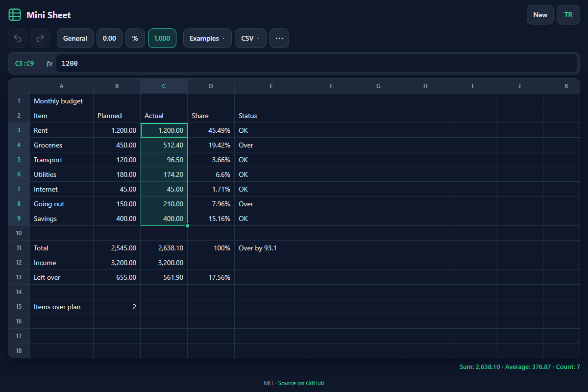

# Mini Sheet - a small spreadsheet in your browser, with its own formula engine

[](#tests)
[](LICENSE)

**▶ Open the app: https://celaldrg.github.io/mini-sheet/**



## Features

- A 26 × 100 grid (A–Z, 1–100). A cell holds a number, text, TRUE/FALSE or a formula starting with `=`.
- Its own tokenizer and recursive-descent parser (no `eval`): `+ - * / ^ &`, comparisons `= <> < > <= >=`, unary minus, percent (`50%`), parentheses, references `A1`, `$A$1`, `$A1`, `A$1` and ranges `A1:B5`.
- 25 functions: SUM, AVERAGE, MIN, MAX, COUNT, COUNTA, ROUND, ABS, SQRT, POWER, MOD, IF, AND, OR, NOT, CONCAT, LEN, UPPER, LOWER, TRIM, LEFT, RIGHT, MID, SUMIF, COUNTIF and VLOOKUP (exact match).
- Errors `#DIV/0!`, `#REF!`, `#NAME?`, `#VALUE!`, `#N/A` and `#CYCLE!` pass through formulas. Error cells are red and explain themselves in a tooltip.
- A dependency graph recalculates only what an edit affects, in order, each cell once. Circular references show `#CYCLE!` until they are broken.
- Copy, paste and fill shift relative references; inserting or deleting rows and columns rewrites every formula.
- Undo and redo for every change. The sheet is saved in your browser.
- CSV import (file, drag and drop, or pasted text) and export (values or formulas), following RFC 4180.
- Number formats: general, two decimals, percent and thousands separators, in English (`1,234.56`) or Turkish (`1.234,56`) style.
- Examples: monthly budget, grade book, multiplication table.
- English and Turkish interface, mobile friendly, dark theme.

## How to use

**Keyboard**

| Key | Action |
| --- | --- |
| Arrow keys | Move the selection |
| Shift + arrows | Select a range (the status bar shows sum, average and count) |
| Typing | Start editing the cell |
| Enter / Tab | Save and move down / right (Shift goes back) |
| Escape | Cancel the edit |
| F2 or double-click | Edit the cell in place |
| Delete / Backspace | Clear the selection |
| Ctrl+C / Ctrl+V | Copy and paste (formulas keep shifting; tab-separated text also goes to the system clipboard) |
| Ctrl+Z / Ctrl+Y | Undo / redo |

**Mouse:** drag to select a range, drag the green square at the corner of the selection to fill, drag a column header edge to resize, right-click for rows, columns and fill actions, click a column letter or row number to select it.

**Touch:** tap a cell to select it, tap it again to edit, drag from the selected cell to select a range, long-press for the cell menu (fill down, fill right, insert and delete rows and columns). The `⋯` button opens the same menu. The grid scrolls inside its own box.

## Run locally

It is a static site with no build step. ES modules need `http://`, not `file://`, so use any static server:

```sh
npx serve .
```

Then open the address it prints.

## Tests

```sh
node --test
```

The suite uses only `node:test` and runs in well under a second. It covers:

- more than 60 formula cases: precedence, right-associative `^`, unary minus, percent, text join, comparisons, every function and error propagation;
- recalculation order: a chain updates fully, and in a diamond every cell is evaluated exactly once;
- cycle detection marks exactly the cells on the cycle and clears them when the cycle is broken;
- reference shifting on copy and fill (relative, absolute, mixed, off the grid) and on row and column insert and delete;
- the CSV parse and serialize round trip on tricky inputs and on 200 seeded random tables;
- a 2,000-cell chain recalculating in under 200 ms;
- undo/redo, number formats, the examples in both languages and the demo state.

## Project structure

```
index.html          page shell
style.css           dark theme, mobile layout
src/
  tokenizer.js parser.js evaluator.js functions.js   formula engine
  sheet.js graph.js shift.js                          cells, recalculation, reference rewriting
  csv.js format.js values.js refs.js rng.js           helpers
  examples.js i18n.js storage.js                      examples, EN/TR strings, safe localStorage
  main.js grid.js menu.js                             user interface
test/               node:test suites
docs/screenshot.png
```

## License

MIT, see [LICENSE](LICENSE).

---

## Türkçe

Mini Sheet, tarayıcıda çalışan, kendi formül motoru olan küçük bir hesap tablosu.

**▶ Uygulamayı aç: https://celaldrg.github.io/mini-sheet/**

### Özellikler

- 26 × 100 tablo (A–Z, 1–100). Hücrede sayı, metin, TRUE/FALSE ya da `=` ile başlayan formül olabilir.
- Kendi sözcük çözümleyicisi ve özyinelemeli iniş ayrıştırıcısı (`eval` yok): `+ - * / ^ &`, karşılaştırmalar `= <> < > <= >=`, tekli eksi, yüzde (`50%`), parantezler, `A1`, `$A$1`, `$A1`, `A$1` başvuruları ve `A1:B5` aralıkları.
- 25 işlev: SUM, AVERAGE, MIN, MAX, COUNT, COUNTA, ROUND, ABS, SQRT, POWER, MOD, IF, AND, OR, NOT, CONCAT, LEN, UPPER, LOWER, TRIM, LEFT, RIGHT, MID, SUMIF, COUNTIF ve VLOOKUP (tam eşleşme).
- `#DIV/0!`, `#REF!`, `#NAME?`, `#VALUE!`, `#N/A` ve `#CYCLE!` hataları formüllerden geçer. Hatalı hücreler kırmızıdır ve ipucunda nedenini söyler.
- Bağımlılık grafiği yalnızca düzenlemenin etkilediği hücreleri, sırayla ve her birini bir kez hesaplar. Döngüsel başvurular kırılana kadar `#CYCLE!` gösterir.
- Kopyala, yapıştır ve doldur göreli başvuruları kaydırır; satır ve sütun ekleme/silme her formülü yeniden yazar.
- Her değişiklik geri alınabilir ve yinelenebilir. Sayfa tarayıcınızda saklanır.
- CSV içe aktarma (dosya, sürükle-bırak ya da yapıştırılan metin) ve dışa aktarma (değerler ya da formüller), RFC 4180'e uygun.
- Sayı biçimleri: genel, iki ondalık, yüzde ve binlik ayırıcı; İngilizce (`1,234.56`) ya da Türkçe (`1.234,56`) yazımla.
- Örnekler: aylık bütçe, not defteri, çarpım tablosu.
- İngilizce ve Türkçe arayüz, telefona uygun, koyu tema.

### Nasıl kullanılır

**Klavye:** ok tuşları seçimi taşır; Shift + oklar aralık seçer (durum çubuğu toplam, ortalama ve adet gösterir); yazmaya başlamak hücreyi düzenler; Enter / Tab kaydedip aşağı / sağa geçer; Escape düzenlemeyi iptal eder; F2 ya da çift tıklama hücrede düzenler; Delete seçimi temizler; Ctrl+C / Ctrl+V kopyalar ve yapıştırır; Ctrl+Z / Ctrl+Y geri alır / yineler.

**Fare:** aralık seçmek için sürükleyin, doldurmak için seçimin köşesindeki yeşil kareyi sürükleyin, sütun genişliği için başlık kenarını sürükleyin, satır, sütun ve doldurma işlemleri için sağ tıklayın.

**Dokunmatik:** seçmek için hücreye dokunun, düzenlemek için tekrar dokunun, aralık seçmek için seçili hücreden sürükleyin, hücre menüsü için basılı tutun (aşağı doldur, sağa doldur, satır ve sütun ekle/sil). `⋯` düğmesi aynı menüyü açar.

### Yerelde çalıştırma

Derleme adımı yoktur. ES modülleri `file://` ile değil `http://` ile çalışır; herhangi bir statik sunucu yeterli:

```sh
npx serve .
```

### Testler

`node --test` çalıştırın. Testler 60'tan fazla formül durumunu, bağımlılık sırasıyla yeniden hesaplamayı ve döngü tespitini, kopyalama ve satır/sütun ekleme/silmede başvuru kaydırmayı, 200 tohumlu rastgele tabloda CSV gidiş-dönüşünü ve 2.000 hücrelik zincirin 200 ms altında hesaplanmasını kapsar.

### Lisans

MIT, bkz. [LICENSE](LICENSE).
